# Flow rezervace

Celé flow v jednom diagramu: odkud rezervace přichází (web, e-chalupy → v zastoupení), platba
na poslední chvíli a s předstihem, kdy se posílají peníze, e-maily a storno. Stav v kódu je
k 2026-11-03 (`server/reservation/states.js`, `payment.js`, `cancellation.js`, `server/email/templates/`).

Diagram je [Mermaid block-beta](https://mermaid.js.org/syntax/block.html): flowchart v mřížce,
kde o poloze uzlů rozhoduje text, ne automatické rozložení. Vykreslí ho GitHub, VS Code (náhled
Markdownu s rozšířením *Markdown Preview Mermaid Support*) i [mermaid.live](https://mermaid.live),
kam jde blok zkopírovat. Upravuje se jako text.

## Diagram

**Hlavní flow** je prostřední sloupec s tlustým okrajem: rezervace z webu s předstihem (19 a více
dní), v jedné přímce od formuláře po pobyt. Okolo jsou alternativní scénáře:

| Kde | Scénář |
|---|---|
| vpravo nahoře | host z e-chalupy: majitel založí rezervaci v zastoupení; nebo rezervace přímo na portálu (jen iCal import) |
| vpravo | zamítnutí; přijetí na poslední chvíli (18 a méně dní): celá částka najednou, vrací se do „Potvrzeno, zaplaceno“ |
| vlevo | propadnutí (záloha nebo platba nedorazila) a storno; obojí jde i z „Čeká na platbu“, šipka by ale křížila hlavní linii |

**Barvy:** modrá stav rezervace · šedá konečný stav (termín uvolněn) · žlutá akce majitele
v adminu · fialová rozhodnutí · zelená peníze k nám · červená peníze od nás · ✉ e-mail, `H`
hostovi, `V` nám · ⏰ automatický e-mail (cron zatím neběží) · úprava rezervace kdykoli → ✉ H9.

**Úpravy:** každý řádek mřížky má 5 buněk (`space` = prázdná), prostřední je hlavní flow.
Šipky jsou pod mřížkou a vedou rovně, takže uzly propojené šipkou mají ležet v sousedních
buňkách nebo ve stejném sloupci. Obdélník `["…"]` se v block-beta roztahuje, proto mají akce
tvar `(["…"])`. Výška řádku je podle nejvyššího uzlu v řádku.

```mermaid
block-beta
  %% Mřížka: každý řádek = 5 buněk (space = prázdná buňka). Prostřední sloupec = hlavní flow
  %% (rezervace z webu s předstihem). Vlevo storno a propadnutí, vpravo vstup z e-chalupy,
  %% zamítnutí a platba na poslední chvíli. Šipky jsou pod mřížkou.
  columns 5

  %% sloupce:  storno | propadnutí, storno | HLAVNÍ FLOW | poslední chvíle | vstupy
  space space WEB(["👤 Host vyplní formulář na webu"]) ECH(["👤 Host z e-chalupy<br/>poptávka, telefon, e-mail"]) space
  space space REQ(["<b>Nová žádost</b> · requested<br/>✉ H1 host · ✉ V1 nám<br/>termín předběžně blokovaný"]) OB(["🛠 Majitel: Nová rezervace<br/><b>V zastoupení hosta</b><br/>pravidla jako web<br/>stav: Čeká na schválení · ✉ H1<br/>nebo Schválená · ✉ H2<br/>nebo Potvrzená · ✉ H5"]) ICAL(["Rezervace přímo na portálu<br/>→ iCal import: jen blokuje termín"])
  space space DEC{"🛠 Majitel<br/>do 24 h"} REJ(["<b>Zamítnuto</b> · rejected · ✉ H3<br/>termín uvolněn"]) space
  space space PLAN{"Kolik dní<br/>do příjezdu<br/>v den přijetí?"} space space
  EXP(["🛠 <b>Propadlo</b> · expired · ✉ H6a<br/>termín uvolněn<br/>🛠 Obnovit → znovu přijetí"]) OVD{"⏰ po splatnosti<br/>✉ V2 nám<br/>i z Čeká na platbu"} AWD_A(["<b>Čeká na zálohu</b> · awaitingDeposit<br/>✉ H2 záloha + doplatek, QR<br/>⏰ H4 24 h před splatností"]) AWD_B(["<b>Čeká na platbu</b> · awaitingDeposit<br/>✉ H2 celá částka, QR<br/>⏰ H4 24 h před splatností"]) space
  space space PAY_DEP[/"💰 Host → my: ZÁLOHA 50 %<br/>do přijetí + 3 dny"/] space space
  space space ACT_DEP(["🛠 Záloha přijata<br/>✉ H5 + QR doplatku"]) PAY_FULL[/"💰 Host → my: CELÁ ČÁSTKA<br/>do přijetí + 3 dny,<br/>nejpozději den před příjezdem"/] space
  FEE{{"Poplatek z ceny podle dní<br/>do příjezdu v den storna<br/>61+ → 0 % · 31–60 → 25 %<br/>15–30 → 50 % · 0–14 → 100 %"}} ACT_CAN(["✂ 🛠 Stornovat · ✉ H6b<br/>na žádost hosta nebo sám<br/>i z Čeká na platbu"]) CONF_DEP(["<b>Potvrzeno, zbývá doplatek</b><br/>confirmed · ⏰ H10"]) space space
  CAN(["<b>Zrušeno</b> · cancelled<br/>termín uvolněn"]) space PAY_BAL[/"💰 Host → my: DOPLATEK 50 %<br/>do příjezdu − 14 dní"/] ACT_FULL(["🛠 Platba přijata<br/>✉ H5"]) space
  REFUND[/"💰 My → host: VRATKA<br/>zaplaceno − poplatek, min. 0<br/>ručně převodem"/] space ACT_BAL(["🛠 Doplatek přijat<br/>bez e-mailu"]) space space
  space space CONF_FULL(["<b>Potvrzeno, zaplaceno</b><br/>confirmed · ⏰ H7 2 dny předem"]) space space
  space space STAY(["🏡 Pobyt"]) space space
  space space ACT_DONE(["🛠 Ukončit pobyt<br/>den odjezdu nebo později · ✉ H8"]) space space
  space space DONE(["<b>Po pobytu</b> · completed"]) space space

  %% legenda
  L1(["stav rezervace"]) L2(["konečný stav"]) L3(["🛠 akce majitele"]) L4[/"💰 peníze k nám"/] L5[/"💰 peníze od nás"/]
  L6(["tlustý okraj = hlavní flow"]) L7(["✉ H host · V nám"]) L8(["⏰ automatický e-mail<br/>cron zatím neběží"]) L9(["úprava kdykoli → ✉ H9"]) space

  %% hlavní flow
  WEB --> REQ
  REQ --> DEC
  DEC -- "Přijmout" --> PLAN
  PLAN -- "19+ dní" --> AWD_A
  AWD_A --> PAY_DEP
  PAY_DEP --> ACT_DEP
  ACT_DEP --> CONF_DEP
  CONF_DEP --> PAY_BAL
  PAY_BAL --> ACT_BAL
  ACT_BAL --> CONF_FULL
  CONF_FULL --> STAY
  STAY --> ACT_DONE
  ACT_DONE --> DONE

  %% e-chalupy → v zastoupení
  ECH --> OB
  ECH -- "přímo na portálu" --> ICAL
  OB --> REQ

  %% zamítnutí
  DEC -- "Zamítnout" --> REJ

  %% poslední chvíle
  PLAN -- "≤ 18 dní" --> AWD_B
  AWD_B --> PAY_FULL
  PAY_FULL --> ACT_FULL
  ACT_FULL --> CONF_FULL

  %% propadnutí (i z Čeká na platbu)
  AWD_A -- "nezaplaceno" --> OVD
  OVD --> EXP

  %% storno (i z Čeká na platbu)
  AWD_A -- "storno" --> ACT_CAN
  CONF_DEP -- "storno" --> ACT_CAN
  CONF_FULL -- "storno" --> ACT_CAN
  ACT_CAN --> FEE
  FEE --> CAN
  CAN --> REFUND

  classDef state fill:#dbeafe,stroke:#1d4ed8,color:#0b1f4d,stroke-width:2px
  classDef ended fill:#e5e7eb,stroke:#4b5563,color:#111827,stroke-width:2px
  classDef owner fill:#fef3c7,stroke:#b45309,color:#3b2203
  classDef decide fill:#ede9fe,stroke:#6d28d9,color:#2e1065
  classDef moneyIn fill:#dcfce7,stroke:#15803d,color:#052e16,stroke-width:2px
  classDef moneyOut fill:#fee2e2,stroke:#b91c1c,color:#450a0a,stroke-width:2px
  classDef guest fill:#ffffff,stroke:#0f766e,color:#042f2e,stroke-width:2px
  classDef muted fill:#f9fafb,stroke:#9ca3af,color:#374151
  classDef main stroke-width:5px

  class REQ,AWD_A,CONF_DEP,CONF_FULL,AWD_B,L1 state
  class REJ,EXP,CAN,DONE,L2 ended
  class OB,ACT_DEP,ACT_BAL,ACT_FULL,ACT_CAN,ACT_DONE,DEC,L3 owner
  class PLAN,OVD,FEE decide
  class PAY_DEP,PAY_BAL,PAY_FULL,L4 moneyIn
  class REFUND,L5 moneyOut
  class WEB,ECH,STAY guest
  class ICAL,L6,L7,L8,L9 muted
  class WEB,REQ,DEC,PLAN,AWD_A,PAY_DEP,ACT_DEP,CONF_DEP,PAY_BAL,ACT_BAL,CONF_FULL,STAY,ACT_DONE,DONE main
```



## Pravidla za diagramem

### Poslední chvíle, nebo s předstihem

Rozhoduje počet dní **od přijetí žádosti** (klik „Přijmout“, nebo založení „Schválené“ v zastoupení)
do příjezdu, ne den, kdy host poslal formulář. Hranice je **18 dní**, ne 14:

| Dní do příjezdu při přijetí | Plán | Splatnost |
|---|---|---|
| 19 a více | záloha 50 % + doplatek 50 % | záloha: přijetí + 3 dny; doplatek: příjezd − 14 dní |
| 15–18 | celá částka najednou | přijetí + 3 dny |
| 14 a méně | celá částka najednou | přijetí + 3 dny, nejpozději den před příjezdem |

Při 15–18 dnech by záloha a doplatek vyšly na stejný den nebo den po sobě, takže se platí jednou
(Caio 2026-11-03). Konfigurace: `server.config.js` → `reservation`.

### Kdy tečou peníze

| Kdy | Kdo → komu | Kolik | Jak to appka pozná |
|---|---|---|---|
| A: do přijetí + 3 dny | host → my | záloha 50 % | majitel klikne **Záloha přijata** |
| A: do příjezdu − 14 dní | host → my | doplatek 50 % | majitel klikne **Doplatek přijat** |
| B: do přijetí + 3 dny | host → my | celá částka | majitel klikne **Platba přijata** |
| při stornu | my → host | zaplaceno − storno poplatek, nejméně 0 | appka spočítá a uvede v H6b, převod dělá majitel ručně |

Všechny platby hosta jdou na účet z Nastavení s jedním variabilním symbolem (`YYMMDDNN`: datum
příjezdu + pořadí). E-maily s výzvou k platbě mají QR platbu. Párování plateb s bankou appka
neumí, zaplacení vždy označí majitel.

### Storno

| Dní do příjezdu v den storna | Poplatek z celkové ceny |
|---|---|
| 61 a více | 0 % |
| 31–60 | 25 % |
| 15–30 | 50 % |
| 0–14 | 100 % |

Vratka = zaplaceno − poplatek, nikdy záporně. Nedoplatek do poplatku se po hostovi
automaticky nevymáhá. Příklady (cena 9 000 Kč):

| Situace | Zaplaceno | Poplatek | Vratka |
|---|---|---|---|
| A, čeká na zálohu, 40 dní před | 0 | 2 250 (25 %) | 0, nic se nevymáhá |
| A, záloha zaplacená, 40 dní před | 4 500 | 2 250 (25 %) | 2 250 |
| A, záloha zaplacená, 20 dní před | 4 500 | 4 500 (50 %) | 0 |
| A, vše zaplacené, 10 dní před | 9 000 | 9 000 (100 %) | 0 |
| B, vše zaplacené, 16 dní před | 9 000 | 4 500 (50 %) | 4 500 |

Stornovat jde jen z **Čeká na zálohu / platbu** a **Potvrzeno**. Nová žádost se nestornuje, ale
zamítá (H3). Na „Propadlo“ přejde rezervace jen po splatnosti, dřív se ukončí stornem.

### Vstup přes e-chalupy

- **Poptávka** (host píše nebo volá z inzerátu na e-chalupách): majitel založí rezervaci
  **V zastoupení hosta** (`reason: "onBehalf"`, `source: "manual"`). Platí pravidla webu
  (kontakt, počet osob, pravidla pobytu), cena podle ceníku, pokud ji nezadá. Počáteční stav:
  - **Čeká na schválení** → jako žádost z webu, host dostane H1, my V1 ne (zakládáme ji sami);
  - **Schválená** → rovnou platební plán podle pravidla výše a H2;
  - **Potvrzená** → H5, bez platebního plánu (peníze řešené mimo appku).
- **Rezervace přímo na portálu**: přijde iCal importem, jen blokuje termín. Stav, e-maily ani
  storno se u ní v appce neřeší, ruší se na portálu.

### Co zatím neběží

Automatické e-maily H4, H7, H10 a V2 mají hotové šablony, ale cron (`reservation/tick`, návrh
v [proposal-reservation-flow.md § 4](./proposal-reservation-flow.md)) není nasazený. Stav nikdy
nemění automat, vždy majitel.

## E-maily

`H` = hostovi, `V` = nám (vlastníkovi). Kódy jsou stejné jako v kódu a v historii rezervace.
Hostovi chodí v jeho jazyce (cs, en, de, pl, sk), nám vždy česky. Každý e-mail hostovi
u ručního kroku jde vypnout zaškrtávátkem „Poslat hostovi e-mail“ a majitel do něj může
připsat „Zprávu hostovi“ (v textu jako `[> zpráva majitele]`). Řádky v `[…]` se vypíšou,
jen když mají obsah.

Patička všech e-mailů hostovi:

```
--
Tento e-mail je generovaný automaticky, neodpovídejte na něj prosím.
Kontakt: {telefon} · {kontaktní e-mail}
```

Skutečnou podobu (HTML i text, všechny jazyky) vyrobí `npm run email:preview` do
`tmp/email-preview/index.html`.

| # | Komu | Kdy | Šablona |
|---|---|---|---|
| H1 | host | odeslání formuláře / založení „Čeká na schválení“ | `requestReceived` |
| V1 | my | odeslání formuláře na webu | `ownerNewRequest` |
| H2 | host | Přijmout / Obnovit / založení „Schválená“ | `depositRequested` |
| H3 | host | Zamítnout | `requestRejected` |
| H4 | host | ⏰ 24 h před splatností zálohy | `depositReminder` |
| H5 | host | Záloha / Platba přijata / založení „Potvrzená“ | `reservationConfirmed` |
| H6a | host | Propadlo | `reservationExpired` |
| H6b | host | Stornovat | `reservationCancelled` |
| H7 | host | ⏰ 2 dny před příjezdem | `arrivalInfo` |
| H8 | host | Ukončit pobyt | `thankYou` |
| H9 | host | úprava rezervace (termín, cena, splatnosti) | `reservationChanged` |
| H10 | host | ⏰ 3 dny před splatností doplatku | `balanceReminder` |
| V2 | my | ⏰ záloha po splatnosti | `ownerDepositOverdue` |

### H1 — Poptávka přijata

**Předmět:** Přijali jsme vaši poptávku — {termín}

```
Dobrý den,

děkujeme za zájem o Roubený ráj. Vaši poptávku jsme přijali a teď ověřujeme dostupnost termínu.

Termín:          {termín}
Počet osob:      {počet osob}
Orientační cena: {cena}
[Vaše poznámka:  {poznámka}]

Termín pro vás zatím předběžně držíme. Ozveme se vám nejpozději do 24 hodin.

Tato zpráva není potvrzením rezervace.

S pozdravem
Roubený ráj
```

### V1 — Nová žádost (nám)

**Předmět:** Nová žádost: {termín}, {jméno}, {počet osob} os.

```
Nová žádost o rezervaci z webu. Termín je předběžně blokovaný.

Termín:     {termín}
Počet osob: {počet osob}
Cena:       {cena}

Jméno:    {jméno}
E-mail:   {e-mail hosta}
Telefon:  {telefon hosta}
[Poznámka: {poznámka}]

Přijmout nebo zamítnout v adminu: {web}/admin/reservation?id={id}
```

Bez patičky; `Reply-To` je host, takže jde odpovědět rovnou.

### H2 — Termín je volný, prosíme o platbu

**A · záloha + doplatek** — předmět: Termín je pro vás volný — prosíme o zálohu do {splatnost zálohy}

```
Dobrý den,

termín {termín} je pro vás volný a rádi vás u nás přivítáme.

Počet osob:   {počet osob}
Celková cena: {cena}
Záloha:       {záloha}, splatná do {splatnost zálohy}
Doplatek:     {doplatek}, splatný do {splatnost doplatku}

[> zpráva majitele]

Platba zálohy
Číslo účtu:        {účet}
Částka:            {záloha}
Variabilní symbol: {VS}
Splatnost:         {splatnost zálohy}
[QR platba zálohy]

Termín pro vás držíme do {splatnost zálohy}. Pokud záloha do té doby nedorazí, rezervaci zrušíme
a termín uvolníme. Jakmile zálohu přijmeme, pošleme vám potvrzení závazné rezervace.

Storno podmínky: 61 a více dní před příjezdem zdarma; 31–60 dní 25 % ceny pobytu;
15–30 dní 50 % ceny pobytu; 14 a méně dní 100 % ceny pobytu.

S pozdravem
Roubený ráj
```

**B · celá částka** — předmět: Termín je pro vás volný — prosíme o úhradu do {splatnost}

```
Dobrý den,

termín {termín} je pro vás volný a rádi vás u nás přivítáme.

Počet osob:   {počet osob}
Celková cena: {cena}
Celá částka:  {cena}, splatná do {splatnost}

[> zpráva majitele]

Platba
Číslo účtu:        {účet}
Částka:            {cena}
Variabilní symbol: {VS}
Splatnost:         {splatnost}
[QR platba]

Termín pro vás držíme do {splatnost}. Pokud platba do té doby nedorazí, rezervaci zrušíme
a termín uvolníme. Jakmile platbu přijmeme, pošleme vám potvrzení závazné rezervace.

Storno podmínky: {storno podmínky}

S pozdravem
Roubený ráj
```

### H3 — Žádost zamítnuta

**Předmět:** Termín {termín} vám bohužel nemůžeme potvrdit

```
Dobrý den,

děkujeme za zájem o Roubený ráj. Termín {termín} vám bohužel nemůžeme potvrdit.

[> zpráva majitele]

Předběžnou blokaci jsme zrušili. Rádi vás přivítáme jindy, volné termíny najdete na webu.

Volné termíny: {web}/cenik

S pozdravem
Roubený ráj
```

### H4 — Připomínka zálohy ⏰

**Předmět:** Připomínka: záloha za pobyt {termín} — splatnost {splatnost zálohy}

```
Dobrý den,

připomínáme, že vaše rezervace v Roubeném ráji na termín {termín} čeká na úhradu zálohy.

Platba zálohy
Číslo účtu:        {účet}
Částka:            {záloha}
Variabilní symbol: {VS}
Splatnost:         {splatnost zálohy}
[QR platba zálohy]

Pokud záloha nebude uhrazena do {splatnost zálohy}, rezervaci zrušíme a termín uvolníme.
Platíte-li na poslední chvíli, pošlete nám prosím potvrzení o platbě na {kontaktní e-mail}
— převod se může připisovat i dva pracovní dny.

Pokud jste už zaplatili, děkujeme a tuto zprávu ignorujte.

S pozdravem
Roubený ráj
```

### H5 — Rezervace závazně potvrzena

**Předmět:** Rezervace je závazně potvrzena — {termín}

**A · zbývá doplatek:**

```
Dobrý den,

zálohu jsme přijali, děkujeme. Vaše rezervace v Roubeném ráji je závazně potvrzena.

Termín:         {termín}
Počet osob:     {počet osob}
Celková cena:   {cena}
Přijatá záloha: {záloha}
Zbývá doplatit: {doplatek}, splatný do {splatnost doplatku}

Platba doplatku
Číslo účtu:        {účet}
Částka:            {doplatek}
Variabilní symbol: {VS}
Splatnost:         {splatnost doplatku}
[QR platba doplatku]

Příjezd od 15:00, odjezd do 10:00. Dva dny před příjezdem vám pošleme informace k pobytu.

Storno podmínky: {storno podmínky}

Těšíme se na vás.
Roubený ráj
```

**B · zaplaceno celé** (i „Potvrzená“ v zastoupení): místo „zálohu jsme přijali“ je „platbu
jsme přijali“ a chybí řádky „Přijatá záloha“, „Zbývá doplatit“ i blok „Platba doplatku“.

### H6a — Rezervace propadla

**Předmět:** Rezervace zrušena — záloha nedorazila: {termín}

```
Dobrý den,

protože jsme do {splatnost zálohy} neobdrželi zálohu, vaši rezervaci termínu {termín} jsme
zrušili a termín uvolnili.

[> zpráva majitele]

Pokud jste zálohu mezitím poslali, ozvěte se nám prosím na {telefon} nebo {kontaktní e-mail}
— domluvíme se.

S pozdravem
Roubený ráj
```

### H6b — Rezervace stornována

**Předmět:** Rezervace zrušena — {termín}

```
Dobrý den,

vaše rezervace v Roubeném ráji na termín {termín} byla zrušena.

[> zpráva majitele]

[Když host něco zaplatil a vratka > 0:]
Podle storno podmínek ({dní} před příjezdem: poplatek  z ceny, tj. {poplatek}) zaplacená
částka {zaplaceno} propadá jako storno poplatek.

Pokud zrušení není podle vašeho přání, ozvěte se nám prosím na {telefon} nebo {kontaktní e-mail}.

S pozdravem
Roubený ráj
```

Když host nic nezaplatil, odstavec o vyúčtování chybí.

### H7 — Informace k příjezdu ⏰

**Předmět:** Informace k příjezdu — {datum příjezdu}

```
Dobrý den,

za dva dny se u nás uvidíme. Tady je vše, co se vám bude hodit:

Adresa:     Libošovice 6, 507 44 Libošovice
Příjezd:    od 15:00
Odjezd:     do 10:00
[Klíče:     {z Nastavení}]
[Parkování: {z Nastavení}]
Kontakt:    {telefon}

Mapa: {odkaz na mapu}

[Zatím neevidujeme doplatek {doplatek}.
 Platba doplatku: účet, částka, VS, splatnost, QR]

Šťastnou cestu!
Roubený ráj
```

### H8 — Děkujeme za návštěvu

**Předmět:** Děkujeme za návštěvu Roubeného ráje

```
Dobrý den,

děkujeme, že jste u nás byli. Doufáme, že jste si pobyt užili.

[> zpráva majitele]

[Ještě evidujeme nezaplacený doplatek {doplatek}.
 Platba doplatku: účet, částka, VS, splatnost, QR]

Těšíme se na další shledání.
Roubený ráj
```

Odkaz na hodnocení zatím není (wip.md).

### H9 — Změna rezervace

**Předmět:** Změna vaší rezervace — {termín}

```
Dobrý den,

ve vaší rezervaci v Roubeném ráji jsme upravili:

- {pole}: {původně} → {nově}

[> zpráva majitele]

Aktuální stav:

Termín:       {termín}
Počet osob:   {počet osob}
Celková cena: {cena}
[Záloha:      {záloha}, splatná do {splatnost zálohy}]
[Doplatek:    {doplatek}, splatný do {splatnost doplatku}]

[Platební údaje a QR k tomu, co je právě k úhradě]

S pozdravem
Roubený ráj
```

### H10 — Připomínka doplatku ⏰

**Předmět:** Připomínka: doplatek za pobyt {termín} — splatnost {splatnost doplatku}

```
Dobrý den,

blíží se váš pobyt v Roubeném ráji, {termín}. Připomínáme splatnost doplatku:

Platba doplatku
Číslo účtu:        {účet}
Částka:            {doplatek}
Variabilní symbol: {VS}
Splatnost:         {splatnost doplatku}
[QR platba doplatku]

Pokud jste už zaplatili, děkujeme a tuto zprávu ignorujte.

S pozdravem
Roubený ráj
```

### V2 — Záloha po splatnosti (nám) ⏰

**Předmět:** Záloha po splatnosti: {termín}, {jméno}

```
Záloha za rezervaci {jméno} ({termín}, VS {VS}) měla dorazit do {splatnost zálohy}.
Rezervace pořád blokuje termín.

Rozhodni v adminu — „Záloha přijata“, „Propadlo“, nebo prodluž splatnost úpravou.

Otevřít rezervaci: {web}/admin/reservation?id={id}
```
